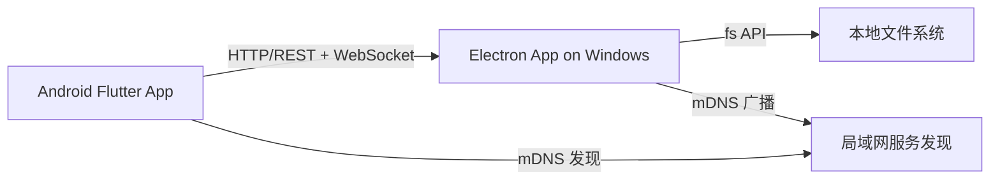

# Flutter 漫画阅读器 - 局域网文件访问方案

## 需求概述

| 项目       | 描述                   |
| ---------- | ---------------------- |
| 文件类型   | 图片文件夹             |
| 读取方式   | 边读边加载（流式读取） |
| 移动端平台 | Android                |
| 电脑端系统 | Windows                |
| 发现方式   | 局域网自动发现         |

---

## 方案对比

### 方案 A：Electron 中转服务器（推荐）

**架构：** Flutter App ←→ Electron App（Windows 端）



**工作原理：**

1. Windows 端运行 Electron 应用，提供文件浏览和流式传输 API
2. Electron 通过 mDNS（Bonjour）广播服务，Flutter 端自动发现
3. Flutter 通过 HTTP Range Request 实现图片的边读边加载

**优点：**

- 提供图形界面，用户可选择共享文件夹、设置权限
- Electron 有完整的 Node.js 生态，文件操作能力强
- 可生成缩略图、缓存索引，提升加载速度
- WebSocket 可实现实时通知（文件变更等）
- 跨平台潜力好（macOS/Linux 适配容易）

**缺点：**

- 需要开发两个应用（Electron + Flutter）
- Electron 安装包较大（~80-150MB）
- 用户需在电脑上安装运行 Electron 应用

**技术栈：**

- Electron + Express / Fastify（HTTP 服务）
- `bonjour-service` 或 `mdns-js`（mDNS 服务发现）
- `chokidar`（文件监听）
- Flutter 端使用 `http` + `multicast_dns` 或 `network_info_plus`

---

### 方案 B：轻量级 Node.js HTTP 服务器

**架构：** Flutter App ←→ Node.js Server（Windows 端）


**工作原理：**

1. Windows 端运行一个轻量 Node.js 脚本（无 GUI）
2. 提供 REST API 用于目录浏览和文件传输
3. 通过 mDNS 广播实现自动发现

**优点：**

- 开发简单，只需一个 JS 文件
- 资源占用少
- 启动快速

**缺点：**

- 无图形界面，配置需要改文件或命令行参数
- 用户体验不如 Electron
- 功能扩展性有限

**技术栈：**

- Node.js + Express / Fastify
- `bonjour-service`（mDNS）
- 命令行运行 `node server.js`

---

### 方案 C：SMB 直接访问

**架构：** Flutter App ←→ Windows SMB 共享


**工作原理：**

1. Windows 开启 SMB 共享文件夹
2. Flutter 通过 SMB 协议直接访问

**优点：**

- 无需在电脑上安装额外软件
- Windows 原生支持 SMB

**缺点：**

- Dart/Flutter 生态中缺乏成熟的 SMB 客户端库
- SMB 协议复杂，实现难度大
- 网络发现依赖 Windows 网络发现服务，不稳定
- 流式读取支持有限
- 安全性配置复杂（防火墙、凭据等）

**结论：不推荐** — 生态支持不足

---

### 方案 D：WebDAV 服务器

**架构：** Flutter App ←→ WebDAV Server（Windows 端）


**优点：**

- WebDAV 是标准协议
- 支持目录浏览和 Range Request

**缺点：**

- 需要在 Windows 上安装配置 WebDAV 服务器
- 自动发现需要额外实现
- 用户体验不够友好

---

## 方案综合评分

| 维度       | A: Electron | B: Node.js | C: SMB | D: WebDAV |
| ---------- | :---------: | :--------: | :----: | :-------: |
| 开发难度   |    中等     |     低     |   高   |   中等    |
| 用户体验   | ⭐⭐⭐⭐⭐  |   ⭐⭐⭐   |  ⭐⭐  |  ⭐⭐⭐   |
| 流式读取   |     ✅      |     ✅     |   ⚠️   |    ✅     |
| 自动发现   |     ✅      |     ✅     |   ⚠️   |    ❌     |
| 可扩展性   | ⭐⭐⭐⭐⭐  |   ⭐⭐⭐   |  ⭐⭐  |  ⭐⭐⭐   |
| 电脑端安装 |    需要     |    轻量    |  无需  |   需要    |

---

## 推荐方案：A + B 混合策略

**推荐采用方案 A（Electron 中转），同时兼容方案 B（轻量 Node.js 服务器）作为后备。**

核心 API 设计保持一致，这样：

- 普通用户可使用 Electron 版（有 GUI，体验好）
- 高级用户可使用 Node.js 版（轻量，无 GUI）

---

## 推荐 API 设计

### REST API 端点

```
GET  /api/servers          - 获取服务器信息
GET  /api/browse?path=xxx  - 浏览目录，返回文件列表
GET  /api/file?path=xxx    - 获取文件（支持 Range Header）
GET  /api/thumbnail?path=xxx - 获取缩略图
GET  /api/search?q=xxx     - 搜索文件
```

### 目录浏览响应格式

```json
{
  "path": "D:/Comics/One Piece",
  "parent": "D:/Comics",
  "entries": [
    {
      "name": "Vol 001",
      "path": "D:/Comics/One Piece/Vol 001",
      "type": "directory",
      "childrenCount": 50
    },
    {
      "name": "001.jpg",
      "path": "D:/Comics/One Piece/Vol 001/001.jpg",
      "type": "file",
      "size": 1234567,
      "mimeType": "image/jpeg",
      "modified": "2024-01-01T00:00:00Z"
    }
  ]
}
```

### mDNS 服务发现

- 服务类型：`_comic-reader._tcp`
- 服务名称：`Comic Reader Server on <hostname>`
- 端口：默认 `9527`
- TXT 记录：`{ version: '1.0', os: 'windows' }`

### 流式读取

通过 HTTP Range Request 实现：

```
GET /api/file?path=D:/Comics/xxx/001.jpg
Range: bytes=0-65535
```

响应：

```
HTTP/1.1 206 Partial Content
Content-Range: bytes 0-65535/1234567
Content-Type: image/jpeg
```

---

## 项目结构规划

### Electron 端（新建项目）

```
comic-reader-server/
├── package.json
├── src/
│   ├── main.js              # Electron 入口
│   ├── server/
│   │   ├── index.js         # HTTP 服务器
│   │   ├── routes/
│   │   │   ├── browse.js    # 目录浏览
│   │   │   ├── file.js      # 文件传输
│   │   │   └── thumbnail.js # 缩略图
│   │   └── middleware/
│   │       ├── cors.js
│   │       └── error.js
│   ├── discovery/
│   │   └── mdns.js          # mDNS 服务发现
│   ├── tray.js              # 系统托盘
│   └── preload.js
├── renderer/                # Electron 设置界面
│   ├── index.html
│   └── settings.js
└── build/                   # 打包配置
```

### Flutter 端（当前项目）

```
lib/
├── main.dart
├── app.dart
├── core/
│   ├── network/
│   │   ├── server_discovery.dart  # mDNS 发现
│   │   ├── api_client.dart        # HTTP API 客户端
│   │   └── server_config.dart     # 服务器配置模型
│   └── models/
│       ├── file_entry.dart
│       └── server_info.dart
├── features/
│   ├── server/
│   │   ├── server_list_page.dart
│   │   └── server_connect_page.dart
│   ├── browser/
│   │   ├── file_browser_page.dart
│   │   └── file_list_tile.dart
│   └── reader/
│       ├── comic_reader_page.dart
│       └── image_loader.dart      # 流式图片加载
└── widgets/
    └── common/
```
