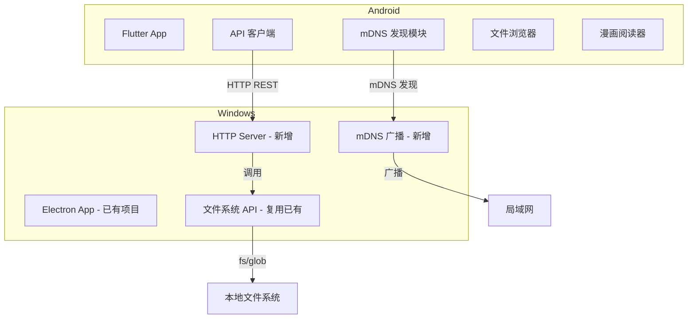

# Flutter 漫画阅读器 - 局域网文件访问方案

## 需求概述

| 项目       | 描述                   |
| ---------- | ---------------------- |
| 文件类型   | 图片文件夹             |
| 读取方式   | 边读边加载（流式读取） |
| 移动端平台 | Android                |
| 电脑端系统 | Windows                |
| 发现方式   | 局域网自动发现         |

---

## 现有 Electron 项目分析

### 技术栈

- **框架**: electron-vite + Vue 3 + TypeScript
- **UI**: Naive UI + Tailwind CSS
- **状态管理**: Pinia
- **数据库**: SQLite3
- **图片处理**: Sharp
- **压缩包**: zip-lib

### 已有的核心模块

| 模块     | 路径                                   | 功能                               |
| -------- | -------------------------------------- | ---------------------------------- |
| 文件操作 | `src/preload/plugins/file.ts`          | 文件夹浏览、文件读取、目录树       |
| 媒体操作 | `src/preload/plugins/media.ts`         | 文件夹树、分页列表、封面、类型检测 |
| 收藏管理 | `src/preload/plugins/favorite.ts`      | 收藏增删查                         |
| 浏览历史 | `src/preload/plugins/browseHistory.ts` | 历史记录                           |
| 标签系统 | `src/preload/plugins/tag.ts`           | 标签管理                           |
| 设置存储 | `src/preload/plugins/appData.ts`       | 持久化设置                         |

### 数据模型

```typescript
// FolderInfo - 文件夹信息
interface FolderInfo {
  name: string;
  fullPath: string;
  createdTime?: Date;
  modifiedTime?: Date;
  fileCount?: number;
  folderCount?: number;
  isLeaf?: boolean;
  contentType?: string; // image | pdf | ebook | mixed | empty | unknown
  coverPath?: string;
  isBookmarked?: boolean;
  children?: FolderInfo[];
}

// FileInfo - 文件信息
interface FileInfo {
  name: string;
  coverPath: string;
  fullPath: string;
  extension: string;
  createdTime: Date;
  modifiedTime: Date;
  size: number;
  formattedSize: string;
}
```

### UI 模式（Flutter 需要参考）

```
┌─────────────────────────────────────────────┐
│  Navbar: [本地目录] [我的收藏] [历史] | 搜索 | 排序  │
├──────────┬──────────────────────────────────┤
│ Sidebar  │  Content Area                    │
│          │  ┌─────┐ ┌─────┐ ┌─────┐       │
│ Folder   │  │Card │ │Card │ │Card │ ...    │
│ Tree     │  │ 封面 │ │ 封面 │ │ 封面 │       │
│          │  │ 名称 │ │ 名称 │ │ 名称 │       │
│          │  └─────┘ └─────┘ └─────┘       │
│          │  (Virtual Grid)                  │
└──────────┴──────────────────────────────────┘
```

---

## 实现方案

### 整体架构



---

## Part 1: Electron 端改造

### 1.1 新增依赖

```bash
npm install bonjour-service
```

> 不需要 Express，使用 Node.js 原生 `http` 模块 + Electron 已有的依赖即可。

### 1.2 新增文件结构

```
src/
├── server/                        # 新增：HTTP 服务模块
│   ├── index.ts                   # HTTP 服务器入口
│   ├── routes/
│   │   ├── browse.ts              # 目录浏览 API
│   │   ├── file.ts                # 文件传输 API（含 Range Request）
│   │   └── thumbnail.ts           # 缩略图 API
│   ├── middleware/
│   │   ├── cors.ts                # CORS 中间件
│   │   └── errorHandler.ts        # 错误处理
│   └── discovery.ts               # mDNS 服务发现
├── main/
│   └── index.ts                   # 修改：启动 HTTP 服务
```

### 1.3 REST API 设计

复用已有的 `file.ts` 和 `media.ts` 中的逻辑，通过 HTTP 暴露：

| 端点                | 方法 | 说明                   | 对应已有函数                          |
| ------------------- | ---- | ---------------------- | ------------------------------------- |
| `/api/server/info`  | GET  | 服务器信息             | -                                     |
| `/api/browse/tree`  | GET  | 文件夹树               | `getFolderTree`                       |
| `/api/browse/list`  | GET  | 文件夹列表（分页）     | `getFolderListPaginated`              |
| `/api/browse/files` | GET  | 文件夹内文件列表       | `getFiles`                            |
| `/api/browse/info`  | GET  | 文件夹详情             | `getFolderInfo` / `loadFolderDetails` |
| `/api/file`         | GET  | 获取文件（支持 Range） | `fs.createReadStream`                 |
| `/api/thumbnail`    | GET  | 缩略图                 | Sharp 处理                            |

### 1.4 API 请求/响应格式

**GET `/api/browse/list?path=D:/Comics&page=0&pageSize=50`**

```json
{
  "path": "D:/Comics",
  "folders": [
    {
      "name": "One Piece",
      "fullPath": "D:/Comics/One Piece",
      "isLeaf": true,
      "contentType": "loading",
      "fileCount": 0
    }
  ],
  "hasMore": true
}
```

**GET `/api/browse/files?path=D:/Comics/One Piece/Vol001`**

```json
{
  "path": "D:/Comics/One Piece/Vol001",
  "files": [
    {
      "name": "001.jpg",
      "fullPath": "D:/Comics/One Piece/Vol001/001.jpg",
      "extension": ".jpg",
      "size": 1234567,
      "modifiedTime": "2024-01-01T00:00:00Z"
    }
  ]
}
```

**GET `/api/file?path=D:/Comics/xxx/001.jpg`**

- 支持 `Range` header 进行流式传输
- 返回 `Content-Type`, `Content-Length`, `Content-Range`
- 返回 `206 Partial Content` 或 `200 OK`

### 1.5 mDNS 服务发现

- 服务类型: `_comic-reader._tcp`
- 端口: 默认 `9527`
- TXT 记录: `{ version: '1.0', hostname: '<computer-name>' }`

### 1.6 设置页面改造

在已有的设置页面中新增"远程访问"标签页：

- 开关：启用/禁用远程访问服务
- 端口配置
- 显示当前连接状态

---

## Part 2: Flutter 端开发

### 2.1 项目结构

```
lib/
├── main.dart
├── app.dart                           # MaterialApp 配置
├── core/
│   ├── network/
│   │   ├── server_discovery.dart      # mDNS 服务发现
│   │   ├── api_client.dart            # HTTP API 客户端
│   │   └── server_config.dart         # 服务器配置模型
│   ├── models/
│   │   ├── folder_info.dart           # 对应 Electron FolderInfo
│   │   ├── file_info.dart             # 对应 Electron FileInfo
│   │   └── server_info.dart           # 发现的服务器信息
│   └── constants/
│       └── api_constants.dart         # API 路径常量
├── features/
│   ├── discovery/
│   │   └── server_discovery_page.dart # 服务器发现/连接页面
│   ├── browser/
│   │   ├── book_browser_page.dart     # 漫画列表（参考 resource-browser）
│   │   ├── folder_tree_sidebar.dart   # 文件夹树侧边栏
│   │   └── media_card.dart            # 漫画卡片（参考 media-card.vue）
│   └── reader/
│       ├── comic_reader_page.dart     # 漫画阅读器（参考 reader/index.vue）
│       ├── image_viewer.dart          # 图片查看器（支持缩放、滑动）
│       └── reader_controls.dart       # 阅读控制栏
└── widgets/
    └── common/
        ├── loading_overlay.dart
        └── empty_state.dart
```

### 2.2 依赖

```yaml
dependencies:
  flutter:
    sdk: flutter
  http: ^1.2.0 # HTTP 客户端
  multicast_dns: ^0.3.2 # mDNS 服务发现
  network_info_plus: ^5.0.0 # 网络信息
  cached_network_image: ^3.3.0 # 图片缓存和加载
  photo_view: ^0.15.0 # 图片缩放查看
  path_provider: ^2.1.0 # 本地路径
  shared_preferences: ^2.2.0 # 简单配置存储
  provider: ^6.1.0 # 状态管理
```

### 2.3 页面流程


### 2.4 Flutter UI 设计（参考 Electron 端）

#### 服务器发现页

- 顶部：自动扫描动画 + "正在搜索附近的服务器..."
- 中部：已发现服务器列表（卡片形式，显示电脑名称、IP 地址）
- 底部：手动输入 IP 地址的输入框 + 连接按钮

#### 漫画列表页（参考 `resource-browser.vue` + `book/index.vue`）

- 顶部 AppBar：搜索框 + 排序按钮 + 刷新按钮
- 主体：GridView 展示漫画卡片
- 每个卡片（参考 `media-card.vue`）：
  - 封面图片（使用 `cached_network_image` 从服务端加载）
  - 文件数量角标
  - 标题（最多两行，超出省略）
- 下拉刷新 + 上拉加载更多
- 底部导航栏可切换：漫画库 / 最近阅读

#### 漫画阅读器（参考 `reader/index.vue` + `type/image.vue`）

- 全屏图片查看
- 左右滑动翻页
- 底部进度条 + 页码显示
- 点击中间区域显示/隐藏控制栏
- 支持缩放手势

---

## 实施步骤

### Phase 1: Electron 端 - HTTP 服务

1. 在 Electron 项目中新增 `src/server/` 目录
2. 实现 HTTP 服务器核心（使用 Node.js `http` 模块）
3. 实现目录浏览 API（复用 `media.ts` 中的逻辑）
4. 实现文件传输 API（含 Range Request 支持）
5. 实现 CORS 中间件
6. 在 `main/index.ts` 中启动 HTTP 服务

### Phase 2: Electron 端 - mDNS 发现

7. 添加 `bonjour-service` 依赖
8. 实现 mDNS 服务广播
9. 在设置页面添加远程访问配置

### Phase 3: Flutter 端 - 基础架构

10. 添加所需依赖到 `pubspec.yaml`
11. 创建数据模型（`FolderInfo`, `FileInfo`, `ServerInfo`）
12. 实现 API 客户端
13. 实现 mDNS 服务发现

### Phase 4: Flutter 端 - UI 实现

14. 实现服务器发现/连接页面
15. 实现漫画列表页（GridView + 封面卡片）
16. 实现漫画阅读器（图片查看 + 翻页 + 进度条）

### Phase 5: 集成与优化

17. 端到端联调测试
18. 性能优化（图片缓存、预加载）
19. 错误处理和重连机制
