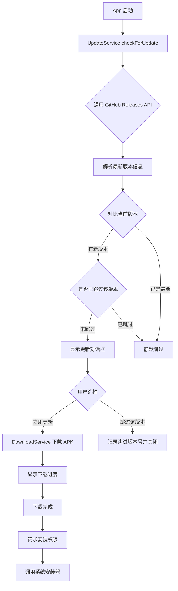
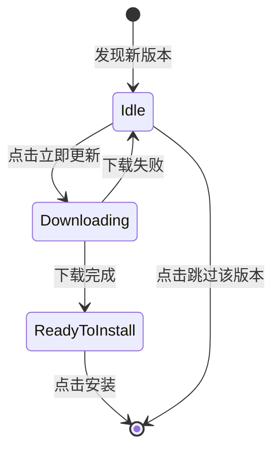

# Flutter Android 应用内更新检测方案

## 概述

基于 GitHub Releases API 实现应用内更新检测、APK 下载和安装功能。支持启动时自动检测和手动触发检测。用户可跳过特定版本，跳过后不再提示该版本更新。

## 架构设计



## 文件结构

```
lib/
├── core/
│   └── services/
│       ├── update_service.dart      # GitHub API 交互 + 版本比较 + 跳过版本管理
│       └── download_service.dart    # APK 下载 + 进度跟踪
├── features/
│   └── settings/
│       ├── update_dialog.dart       # 更新通知对话框 UI（含跳过版本选项）
│       └── settings_page.dart       # 设置页面（含手动检测入口）
```

## 1. 依赖项变更

### pubspec.yaml 新增依赖

```yaml
dependencies:
  package_info_plus: ^8.0.0 # 获取当前应用版本号
  dio: ^5.4.0 # HTTP 客户端（支持下载进度）
  open_filex: ^4.5.0 # 调用系统安装器打开 APK
  url_launcher: ^6.2.0 # 备用：打开浏览器跳转 Release 页面
```

> **说明**：项目已有 `http` 包，但 `dio` 提供了更好的下载进度回调支持，适合大文件下载场景。

## 2. Android 权限配置

### AndroidManifest.xml 新增权限

```xml
<!-- 安装 APK 权限 (Android 8.0+) -->
<uses-permission android:name="android.permission.REQUEST_INSTALL_PACKAGES" />
<!-- 写入外部存储 (Android 9 及以下) -->
<uses-permission android:name="android.permission.WRITE_EXTERNAL_STORAGE"
    android:maxSdkVersion="28" />
```

> **注意**：`REQUEST_INSTALL_PACKAGES` 是 Android 8.0 (API 26) 及以上安装 APK 必需的权限。用户需要在系统设置中手动授权。

### FileProvider 配置（可选但推荐）

为了在 Android 7.0+ 上正确分享 APK 文件给系统安装器，需要配置 FileProvider：

**AndroidManifest.xml** 中 `<application>` 内添加：

```xml
<provider>
    android:name="androidx.core.content.FileProvider"
    android:authorities="${applicationId}.fileprovider"
    android:exported="false"
    android:grantUriPermissions="true">
    <meta-data
        android:name="android.support.FILE_PROVIDER_PATHS"
        android:resource="@xml/file_paths" />
</provider>
```

**res/xml/file_paths.xml**（新建）：

```xml
<?xml version="1.0" encoding="utf-8"?>
<paths>
    <external-cache-path name="apk" path="." />
</paths>
```

## 3. 核心服务实现

### 3.1 UpdateService（更新检测服务）

**文件**：`lib/core/services/update_service.dart`

**职责**：

- 调用 GitHub Releases API 获取最新版本信息
- 解析版本号、更新日志、APK 下载链接
- 与当前版本比较，判断是否需要更新
- 检查用户是否已跳过该版本（通过 `shared_preferences` 存储）
- 提供「跳过该版本」功能，记录跳过的版本号

**GitHub API 端点**：

```
GET https://api.github.com/repos/{owner}/{repo}/releases/latest
```

**响应关键字段**：

```json
{
  "tag_name": "v0.2.0",
  "name": "Comic Reader v0.2.0",
  "body": "更新日志内容...",
  "assets": [
    {
      "name": "app-release.apk",
      "browser_download_url": "https://github.com/..."
    }
  ],
  "html_url": "https://github.com/..."
}
```

**版本比较逻辑**：

- 当前版本来自 `package_info_plus` 的 `version` 字段（对应 `pubspec.yaml` 的 `version`）
- 远程版本来自 GitHub Release 的 `tag_name`（去掉 `v` 前缀）
- 使用语义化版本比较（major.minor.patch）

**配置项**（硬编码或后续改为可配置）：

```dart
static const String githubOwner = 'YOUR_GITHUB_USERNAME';
static const String githubRepo = 'comic_reader';
```

### 3.2 DownloadService（下载服务）

**文件**：`lib/core/services/download_service.dart`

**职责**：

- 使用 `dio` 下载 APK 文件
- 报告下载进度（0-100%）
- 下载完成后调用系统安装器

**下载流程**：

1. 获取应用缓存目录（`path_provider` 的 `getExternalStorageDirectory` 或 `getApplicationSupportDirectory`）
2. 使用 `dio.download()` 下载 APK，监听 `onReceiveProgress`
3. 下载完成后通过 `open_filex` 调用系统安装器

**关键代码逻辑**：

```dart
// 下载 APK
await dio.download(
  downloadUrl,
  savePath,
  onReceiveProgress: (received, total) {
    if (total > 0) {
      final progress = (received / total * 100).toInt();
      onProgress?.call(progress);
    }
  },
);

// 安装 APK
await OpenFilex.open(savePath);
```

## 4. UI 实现

### 4.1 UpdateDialog（更新对话框）

**文件**：`lib/features/settings/update_dialog.dart`

**功能**：

- 显示新版本号
- 显示更新日志（纯文本）
- 「立即更新」按钮 → 触发下载
- 「跳过该版本」按钮 → 记录跳过版本号并关闭对话框
- 下载进度条（下载中显示）
- 「安装」按钮（下载完成后显示）

**跳过版本逻辑**：

- 使用 `shared_preferences` 存储已跳过的版本号（key: `skipped_version`）
- 自动检测时，如果最新版本号等于已跳过的版本号，则不弹出对话框
- 手动检测时，无论是否跳过过，都弹出对话框

**状态流转**：



### 4.2 SettingsPage（设置页面）

**文件**：`lib/features/settings/settings_page.dart`

**功能**：

- 显示当前版本号
- 「检查更新」按钮 → 手动触发更新检测
- 检测中 loading 状态
- 检测结果提示（已是最新 / 发现新版本）

## 5. 启动时自动检测集成

**修改文件**：`lib/main.dart` 或 `ServerDiscoveryPage`

在 `ServerDiscoveryPage` 的 `initState` 中调用：

```dart
@override
void initState() {
  super.initState();
  _checkForUpdate();
}

Future<void> _checkForUpdate() async {
  final updateService = UpdateService();
  final result = await updateService.checkForUpdate();
  if (result.hasUpdate && mounted) {
    showUpdateDialog(context, result);
  }
}
```

> **注意**：自动检测应添加频率限制（如每天最多检测一次），可通过 `shared_preferences` 记录上次检测时间。项目已有 `shared_preferences` 依赖。

## 6. 注意事项

1. **GitHub API 速率限制**：未认证请求限制为 60 次/小时/IP。对于个人应用足够。如需更高限制，可添加 GitHub Token（但不建议硬编码在客户端）。

2. **版本号规范**：`pubspec.yaml` 中的 `version` 字段和 Git tag 保持一致，如 `version: 0.2.0+2`，tag 为 `v0.2.0`。`+` 后的数字是 `versionCode`（构建号），每次发布递增。

3. **APK 签名**：Release APK 必须使用相同的签名密钥，否则无法覆盖安装。当前项目使用 debug 签名，正式发布前需要配置自己的签名密钥。

4. **存储权限**：Android 10+ 使用 Scoped Storage，应用缓存目录不需要额外存储权限。APK 下载到应用专属缓存目录即可。

5. **安装权限**：Android 8.0+ 需要用户在系统设置中授予「安装未知应用」权限。`open_filex` 会自动引导用户到设置页面。

6. **HTTPS**：GitHub API 和下载链接均为 HTTPS，Android 9+ 默认不允许 HTTP 请求，这里不受影响。

## 7. 实施步骤总结

| 序号 | 任务              | 涉及文件                                            |
| ---- | ----------------- | --------------------------------------------------- |
| 1    | 添加依赖          | `pubspec.yaml`                                      |
| 2    | 添加 Android 权限 | `AndroidManifest.xml`, `res/xml/file_paths.xml`     |
| 3    | 实现更新检测服务  | `lib/core/services/update_service.dart`             |
| 4    | 实现下载服务      | `lib/core/services/download_service.dart`           |
| 5    | 实现更新对话框 UI | `lib/features/settings/update_dialog.dart`          |
| 6    | 实现设置页面      | `lib/features/settings/settings_page.dart`          |
| 7    | 集成自动检测      | `lib/features/discovery/server_discovery_page.dart` |
